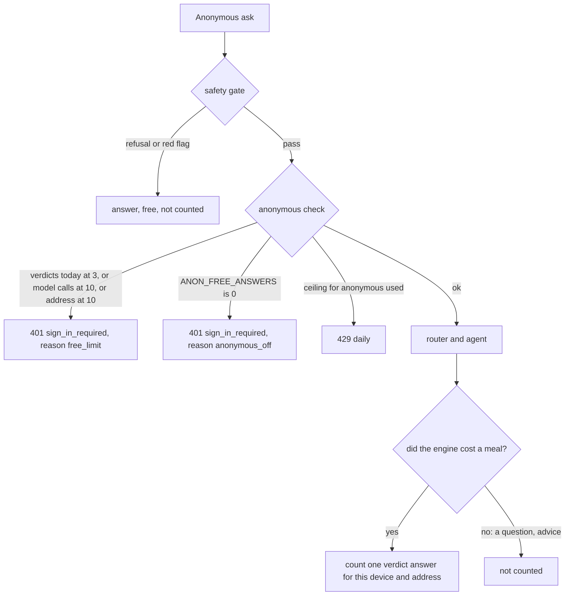

# Engineering plan — A free first answer without signing in

*Stage 1, 20 November 2026. Decided by the owner in chat the same day; the plan comes from `docs/COMPETITIVE-PLAN.md` item B4. The previous plan (fix an assumed weight on the receipt, built and live) is kept as `docs/engineering/recorrect-weights.md`. Nothing is built until this document is approved.*

## 1. Summary

**The feature.** A visitor with no account asks up to three questions a day and gets the full answer: the verdict, the figures, the receipt, the named weights and the one-tap weight correction. There is no email, no onboarding and no diary. When the three are used the screen offers to sign in by email to go on. Saving a diary, the profile on a server, the Menu and the clinician summary stay behind sign-in.

**The problem.** Today `REQUIRE_SIGN_IN` is on: a stranger sees the landing page, then an email sign-in, before they can ask anything. Every direct competitor lets a person start at once (a photo, a barcode, a label, a few free scans a day), and most have a free tier. The wall is the main reason a person never reaches what DiaBite does better: the first minute (`docs/COMPETITIVE-PLAN.md`, findings 1 and A/B). The wall also protects the money: every answer is a model call, and `POST /agent/ask` needs no key because a browser cannot hold one. This plan removes the wall for three answers and keeps the protection by other means.

**What it changes in the product's own rules.** `docs/PRD-product.md` (read only) says accounts are required "so every user is a known person who can be asked what happened" (decided 10 October 2026). This feature reverses that for the first answers. The PRD copy belongs to the finance session; the owner must tell it (section 12).

**How success is measured.**

| Measure | Source | Target to judge after two weeks |
|---|---|---|
| Anonymous devices with at least one verdict answer a day | the turn log (`anon: true`, a random device key) | more than the number of new accounts a day, which is the whole of today's funnel |
| Share of those that reach the limit and see the sign-in offer | the turn log (`freeLimit`) | to be read, not a target |
| Sign-ups a day, against the seven days before | Supabase `auth.users` (counts only) | up |
| Refusals and 502s for signed-in people | the existing `rate_limited` and 502 log events | no increase |
| Cost: anonymous model turns as a share of the daily ceiling | the ceiling counters | under the anonymous ceiling every day |

## 2. Scope

**In scope**

- Anonymous access to `POST /agent/ask` and `POST /meal/recompute` while `ANON_FREE_ANSWERS` is greater than 0 (three at the start).
- A counter per device and per address, in memory, for verdict answers; a hard cap on all anonymous model calls; a separate anonymous daily ceiling.
- A neutral typical profile for the anonymous visitor, said on the card ("Counting for a typical adult. Make it yours"), never stored on a server.
- The Ask screen for an anonymous visitor: no **Log it**, a banner, and at the limit one plain offer to sign in.
- The Diary, Menu and You tabs and the clinician summary show a sign-in card; Settings keeps appearance, help and sign-in.
- The landing page's key goes to the Ask screen, not to the sign-in form.
- Engine, abuse and rehearsal cases in the same change.

**Out of scope**

- A photo, a barcode or a label (separate items B5 and B6).
- Carrying the last free answer into the diary after sign-in (decided: a plain offer only).
- A CAPTCHA now (decided: limits and a separate ceiling; Cloudflare Turnstile later if abuse is seen; any CAPTCHA the owner completes herself).
- A safety screen before the first answer (decided by the owner: none; see section 9 for what stays and the risk).
- Showing anonymous visitors a consent card. The typed-question log is unchanged for them (decided by the owner; see sections 8, 9 and 12).

**Later**

- Carry-over of the free answer into the diary; a short privacy line under the question box; Turnstile; a per-region neutral profile.

## 3. User flows

```
A stranger opens diabite.pro
  → Landing: "Ask a question" (no email)  /  "Sign in"
  → Ask screen, anonymous: neutral profile, banner "Counting for a typical adult. Make it yours"
  → types "a medium apple and 4 oz of chicken"
  → Frontend: POST /agent/ask { sessionId (random), message, budget (neutral), units: imperial, entries: [] }
              header x-diabite-device: <random id kept in this browser>
  → Engine: size and shape → the safety gate (free, never withheld) → anonymous check (device, address) → router → meal agent → tools → verifier
  → Agent: unchanged (no preference memory read or written)
  → Data: nothing stored about the person; counters in memory; the turn log line as before (random session id, the question)
  → Response: the answer; the engine's trace shows a costed meal, so it counts as one of the three
  → Frontend: the full answer, receipt, weights line, one-tap correction; the count is not shown until it matters
```



Other flows: **at the limit** (the fourth verdict, or the tenth model call): the 401 carries `reason: free_limit` and `retryAfterSec`; the screen shows the offer and keeps the answer on screen. **A weight correction by an anonymous visitor**: `POST /meal/recompute` with the same device header; arithmetic only, so it is not counted, and it has its own per-address limit. **Signing in from the banner**: the existing email flow, then the existing onboarding with its safety exits and consent card; the visitor's anonymous answers are not carried over.

## 4. The promise check

Nothing about the numbers changes. Every figure the anonymous visitor sees is computed by the engine and checked by the verifier exactly as for a signed-in person. **One thing is new and must be said plainly: the budget is not the visitor's.** The "left after" figure and the verdict word are computed from the neutral profile's targets. The screen says so beside the figure ("for a typical adult") and the engine does not change: `afterMeal.fits` is still the only source of the verdict. The neutral profile's numbers are inputs from the product, not from a model. Where a person's own numbers matter (the carbohydrate limit, excluded foods, units) they are absent for the anonymous visitor and the answer does not pretend otherwise.

## 5. Frontend

**Files:** `src/App.tsx` (the gate), `src/lib/auth.ts` (`useSignInRequired` returns what the engine says about free answers), `src/lib/agent.ts` (the device header, the refusal reason), `src/lib/device.ts` (new: the random device id), `src/lib/profile.ts` (the neutral profile), `src/components/Landing.tsx`, `src/components/AskPage.tsx`, `src/components/SignInCard.tsx` (new: the card the locked tabs show), `src/components/SettingsPage.tsx`, `docs/design.md` (a paragraph, written before CSS), `src/styles.css` (existing tokens only).

**The gate.** `/health` answers `{ ok, records, signIn: true, freeAnswers: 3 }`. With `signIn` true and `freeAnswers` greater than 0, a signed-out visitor who presses **Ask a question** on the landing page gets the app in anonymous mode; **Sign in** keeps the existing form. With `freeAnswers` 0 or absent the behaviour is exactly today's. The anonymous state is held in memory and in `sessionStorage` only for the tab; nothing about the neutral profile is written to `localStorage` (so a later real onboarding starts empty).

| State | What the person sees |
|---|---|
| landing | the key "Ask a question" (no email) and a quieter "Sign in"; the line "You sign in with your email, there is no password" moves to the sign-in key |
| anonymous Ask | the usual Ask screen; under the budget bar one line, "Counting for a typical adult. Make it yours", the second sentence a button that opens sign-in; no day picker, no **Log it** (it reads **Sign in to log this**), the receipt and **Portions** as for anyone |
| Diary, Menu, You | a card, "Sign in to keep a diary" (and the same sentence for the menu and the targets), one key, no content behind it |
| Settings | appearance, Help and a **Sign in** key; no account block, no export |
| an answer that is a question or a refusal | as today; it is not counted |
| the limit | under the answer, one card: "That was your third free answer for today. Sign in by email to go on, keep a diary and make the numbers yours." with the key **Sign in**; asking again shows the same card, with how long until another is free ("in about 6 hours") |
| signed out in the middle (a session ended) | unchanged |
| offline or a 502 | the existing messages |

**Phone (375 px):** the banner wraps under the budget; the card and the key are full width; nothing is wider than the Ask screen today. **Accessibility:** the banner is text; the card is ordinary content read in order; the focus ring is the existing one; the offer is announced by the existing live region.

## 6. Engine and API

**`GET /health`** adds `freeAnswers: number` (the value of `ANON_FREE_ANSWERS`, 0 when off). Public, as now.

**`POST /agent/ask`** (public; no key; a caller with the engine key is exempt as today):

- New request header `x-diabite-device`: a version-4 UUID the browser keeps. A missing or malformed value means the device is unknown: the visitor then shares the address's allowance (the same three, once per address), so omitting the header never gives more.
- In `answer()` (`server/agent.ts`), after the safety gate and where today `requireSignIn && !trusted && !person` throws `SignInRequired`, the order becomes:
  1. person present → unchanged;
  2. no person and `requireSignIn`: if `ANON_FREE_ANSWERS` is 0 → `SignInRequired('anonymous_off')`; else `chargeAnon(deviceKey, addressKey)` which throws `SignInRequired('free_limit', retryAfterSec)` when the device has used its verdict answers, its model calls, or the address its verdict answers, and `RateLimited('daily', …)` when the anonymous ceiling is used;
  3. the existing `claimSession`, `chargeTurn` (the per-address 30 in 10 minutes and 200 a day, the per-session 60 an hour, the global daily ceiling) run for anonymous callers too.
- After the answer is built: if there was no person and the engine's trace holds a `compute_meal` or `cost_dish` result with `totals` (a costed meal: the verdict, a partial verdict and an estimate all count), `countFreeAnswer(deviceKey, addressKey)` records one verdict answer. A clarifying question, a `needsWeight` question, advice and a refusal do not count. Two requests in flight at once can overshoot by one; the model-call cap bounds it.
- **Limits** (new, all read per call like the others; defaults): `ANON_FREE_ANSWERS` 3 verdict answers per device in a rolling 24 hours; `ANON_MODEL_CALLS_DAY` 10 model turns per device in a rolling 24 hours; `ANON_ADDRESS_ANSWERS_DAY` 10 verdict answers per address in a rolling 24 hours (a household or an office shares them); `ASK_ANON_DAILY_CEILING` 150 anonymous model turns a day (UTC), counted inside the global `ASK_DAILY_CEILING` of 1,000, so a flood of anonymous traffic cannot use up what registered people need.
- **Errors:** `401 { error: 'sign_in_required', reason: 'free_limit' | 'anonymous_off', retryAfterSec? }`; `429` with `Retry-After` for the existing scopes plus `scope: 'anon_daily'`.
- **No memory:** for an anonymous turn `recallPreferences` is not called and `rememberPreferences` is not called (the advisor's preference store is keyed by the session id; no preference is kept for a person who has not signed in).
- **The log:** `logTurn` adds `anon: true` and `freeLimit: true` where they apply, and keeps its rule: a random session id, never an account, email or address. The question text is logged as for everyone (section 8).

**`POST /meal/recompute`**: today a missing token is `401` while sign-in is required. With free answers on, a request with no token is accepted when it carries a valid device header, and is charged to a new per-address bucket (`RECOMPUTE_ANON_MIN`, default 20 a minute) in addition to the existing one. It is arithmetic only, so it is not counted as an answer. `claimSession` is unchanged (an anonymous session has no owner).

**`PUT /session/:id`**, the tools and everything else: unchanged (tool key).

No migration, no new table, no new route. **New settings** (Container App environment, not secrets): `ANON_FREE_ANSWERS`, `ANON_MODEL_CALLS_DAY`, `ANON_ADDRESS_ANSWERS_DAY`, `ASK_ANON_DAILY_CEILING`, `RECOMPUTE_ANON_MIN`. They are added to `.env.example` with a comment each.

## 7. Agents

**No prompt change, no tool-spec change, no re-provision.** The meal agent answers the anonymous visitor from the same tools. The advisor runs without its preference store for anonymous turns (section 6). `eval:agent` is run in full after deploy because `compute_meal` is unchanged but the request now reaches the agent with a neutral budget and no entries; the existing cases already do that.

## 8. Data

**Tables, migrations: none.** What is stored about an anonymous person:

| Where | What | How long | Tied to a person? |
|---|---|---|---|
| the browser (`localStorage`) | a random device id, nothing else | until cleared | no |
| the engine's memory | counters keyed by a hash of the device id and a hash of the address | a day, lost at a restart | no |
| the turn log (Log Analytics) | the question text, a random session id, the result, `anon: true` | 30 days | no name, email or address |

**The owner decided on 20 November 2026 that anonymous questions are kept for evaluation, with no notice.** For the record, the plan does not invent a notice. Two facts for the owner in section 12: the typed text can carry health detail ("I take metformin and my A1c is 7.2"), and the consent text for signed-in people was drafted without counsel; the data is held in an EU region, so a visitor from the EU is covered by GDPR whether or not they are the audience.

## 9. Safety and responsible AI

- **The rules gate is untouched and stays first** (CLAUDE.md rule 6): dosing, red flags, fasting and referral are caught before any limit, for anonymous callers too, and a refusal is free and never counted.
- **No safety screen before the first answer (the owner's decision).** Today the questionnaire is the only thing that stops a person under 18, a pregnant or breastfeeding person, or someone who doses insulin with food from getting a verdict (PRD A5: "not for you"). The anonymous visitor skips it. The rules gate still catches the words (a dose, a hypo), and the non-dismissible disclaimer stays in the masthead. **What is lost is the screen that says "not for you" to a person who has not said a word about it.** Proposed, for the owner's yes, as disclosure and not as a screen: a permanent line under the neutral-profile banner, "For adults. Not for mealtime insulin or pregnancy. Not medical advice." Not screening, but it is said every time. The sign-in that follows runs the full onboarding with the exits.
- **The neutral profile.** Type 2 diabetes, no insulin, a moderate carbohydrate approach, goal maintain; the numbers (age, sex, height, weight, activity) are those of the app's default profile with only the condition, the approach and the goal changed. The targets come from the same formulas as everyone's, so the glycemic-load budget is not invented. **A clinician should review** the neutral profile and the "typical adult" wording; until one has, the card says so in its own words.
- **What could mislead.** A verdict "fits" computed for a typical adult read as "fits for me". Mitigation: the banner next to the figure, and the first sign-in step is the person's own numbers. A person who is not the typical adult may read a wrong day budget; the engine's own numbers (the meal's glycemic load and carbohydrate) are still right.
- **Cost and abuse.** The per-device and per-address limits, the model-call cap, the anonymous ceiling inside the global one, and the existing per-address and per-session limits; abuse cases prove each (section 10). A script that changes its device id at every request is stopped by the address limits (10 verdict answers and the 30 in 10 minutes) and by the anonymous ceiling; a CAPTCHA is the next step if this shows in the log.
- **A clinician should review** nothing in the medical logic: no threshold, target or health sentence changes except the neutral profile and the disclosure line.

## 10. Evaluation plan

All in the same change. Mechanical checks read status codes, fields and counters; none reads the wording of an answer.

**Engine (`eval/run-engine.ts`)**

| Id | Check |
|---|---|
| AN1 | `countsAsFreeAnswer(trace)`: true for a result with a `compute_meal` or `cost_dish` that has `totals`; false for a `needsWeight` reply, a clarifying question, an advisory turn and a gate refusal |
| AN2 | the anonymous allowance (`chargeAnon`, `countFreeAnswer`) with small values: three verdicts admitted, the fourth refused with `free_limit` and a positive `retryAfterSec`; the ten-model-call cap refuses even when no verdict was counted; a different device with the same address is stopped by the address cap; a missing or malformed device id shares the address allowance |
| AN3 | `ANON_FREE_ANSWERS=0` refuses with `anonymous_off` |
| AN4 | the anonymous ceiling is inside the global one: with the global ceiling set to 3 and the anonymous one to 2, the third anonymous turn is refused and a signed-in turn is still admitted |
| AN5 | the neutral profile: `exitReason` is `null`; its targets are within the app's own bounds; a changed condition, approach and goal are the only differences from the default profile |

**Abuse (`eval/run-abuse.ts`, no model, no money)**

| Id | Check |
|---|---|
| ANA | with sign-in required and free answers on, an anonymous request with a device header is admitted (200 or 502, never 401); without the header it is admitted as an address-only visitor; the safety gate replies to an anonymous dosing phrase with its refusal and spends nothing |
| ANB | past the model-call cap the same request is `401` with `reason: free_limit` and the body has no other field of substance |
| ANC | `/meal/recompute` without a token and with a device header is `200` while free answers are on and `401` when `ANON_FREE_ANSWERS` is 0; past `RECOMPUTE_ANON_MIN` it is `429` with `Retry-After` |
| AND | `/health` carries `freeAnswers` and nothing else new |
| ANE | the key-holding caller (the agent evals) is exempt from the anonymous limits, as from the others |

**Screens (static render, `eval/run-engine.ts`)**: the landing key goes to the Ask screen; the banner text and the sign-in button; **Log it** reads **Sign in to log this** and is absent for a signed-in person's flow; the locked tabs render the sign-in card; at the limit the card has the exact copy; with `freeAnswers` 0 the landing and the gate render exactly as today.

**Rehearsal (`eval/rehearsal.mjs`, W21):** a fresh browser, no account: press "Ask a question", ask a meal, see an answer with a receipt, correct a weight (it recounts), ask two more, press ask a fourth and read the sign-in card; reload and read that the limit stands; open the Diary tab and read the sign-in card. The throwaway device leaves nothing.

**Mutations.** Count a question as an answer (AN1 fails); remove the model-call cap (AN2 fails); put the anonymous ceiling outside the global (AN4 fails); let an unparsable device header skip the address allowance (AN2 fails); drop the gate-first order (ANA fails).

**Agent evals.** `npm run eval:agent` in full after deploy; no new case is needed because no agent path changes.

## 11. Rollout

1. Build in this order: the guard and `answer()` changes with AN1 to AN5 and ANA to ANE; `/health`; the neutral profile and the device id; the screen; `docs/design.md` before the CSS.
2. `npm run eval`, `npm run eval:abuse`, the smoke test.
3. Deploy the image (CLAUDE.md rule 1: read the image tag the app runs; the 19 November deploy that went out with the previous image is the reason). **The feature is off until the setting is set:** `ANON_FREE_ANSWERS` defaults to 0, so a deploy changes nothing. Turn it on with one revision: set `ANON_FREE_ANSWERS=3` on the Container App.
4. Ask the running service: an unauthenticated `POST /agent/ask` with a device header and a meal is admitted; the fourth verdict is `401 free_limit`; `GET /health` says `freeAnswers: 3`.
5. Run the rehearsal W21, then `npm run eval:agent`.
6. Look at it on the live app at 375 px and at desktop width, in Tape and in Paper, signed out.
7. **Rollback:** set `ANON_FREE_ANSWERS=0` (one revision, no build): `/health` stops advertising it, the landing key goes back to the sign-in form, and an anonymous request is `401 anonymous_off` again. Nothing stored needs undoing.
8. Watch for a week: the anonymous share of the ceiling, the `rate_limited` events, and the cost line in Azure; the owner's budget alert (WORKLIST) already covers the month.

## 12. Open questions

**Decided by the owner on 20 November 2026:** the visitor is a device plus an address, counted in memory; a verdict answer is what counts (a question or a refusal is free), with a hard cap on all model calls; the profile is neutral (type 2, moderate carbohydrate, maintain weight) and the card says whose numbers they are, with an invitation to sign up for one's own; no safety screen before the first answer; at the limit a plain offer to sign in, no carry-over; limits and a separate ceiling now, a CAPTCHA later; anonymous questions are kept for evaluation without a notice.

**For the owner, still open (none blocks the build):**

1. **The PRD decision of 10 October** ("sign-in required so every user is a known person") is reversed for three answers. The PRD copy is the finance session's; it needs telling.
2. **Anonymous questions without a notice.** The text can carry health detail and the data is held in an EU region; the consent text has had no counsel. A one-line privacy sentence under the question box would cost nothing and can be added later; the plan builds none because the owner decided so. Counsel on this is already an open item in `docs/security/security-plan.md`.
3. **No safety screen.** The rules gate and the disclaimer stay; the proposed disclosure line ("For adults. Not for mealtime insulin or pregnancy. Not medical advice.") needs a yes, and the residual risk (a minor or a person on mealtime insulin gets a verdict) is accepted by the owner.
4. **The neutral profile's numbers** (the app's default profile with condition type 2, approach moderate, goal maintain) belong to a clinician when one reads the pack (WORKLIST №39, №60).
5. **The ceiling numbers** (150 anonymous turns a day inside 1,000; 10 model calls and 3 verdicts per device; 10 verdicts per address) are engineering defaults against a cost the owner knows better; they are settings, not code.
6. **The first sign-in after an anonymous session** loses the anonymous answers (decided); revisit with the numbers from week one.
