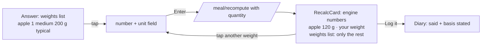

# Engineering plan — Fix an assumed weight on the receipt in one tap

*Stage 1, 19 November 2026. The owner decided it in chat the same day ("да, делай") and chose the three open product questions (section 12). The previous plan (US household measures) is kept as `docs/engineering/us-household-measures.md`. Nothing is built until this document is approved.*

## 1. Summary

**The feature.** The answer already names every weight the app assumed ("Weights I used: apple 1 medium (200 g)", and the pill **typical size** when USDA lists only a regular one). Today a person can correct a weight only with the − and + steppers of "Not what you ate?", or by retyping the whole meal in grams. They cannot type "the apple was 120 g", or "3 oz of chicken", on the weight they are looking at.

The change: the weight of each line is a button. Tap it, type a number, pick a unit, and the engine counts the meal again. The corrected line becomes **the person's own** (`basis: stated`, marked **your weight**), it leaves the "Weights I used" list, the meal's numbers are recomputed, and the Diary stores the corrected weight. When nothing assumed is left, the list is gone: every weight on the card is the person's.

**The problem it answers.** PRD "The one promise" and the claim in the pitch deck: *DiaBite names every weight it assumed, and one sentence corrects it.* The first half is true; the second is half true. A named assumption that cannot be corrected where it is shown is a disclosure, not a control. Success is measured by: (a) a correction is one tap and one number, on a phone; (b) every number after a correction is the engine's, and the Verified badge is never attached to numbers it did not check; (c) in the five moderated sessions (`docs/USER_SESSIONS.md`, questions 3 and 4: does the person notice the weights line and trust the numbers) the correction is used without being explained.

**What the code already does, so this plan does not duplicate it** (read, not assumed):

- `PortionEditor` in `src/components/AskPage.tsx` steps each line (− / +), by the food's own measure on US units, and the browser asks `POST /meal/recompute` (`server/engine.ts`), which costs the items with `computeMeal` and the session's day, with no model, behind the sign-in wall and a per-address limit (`chargeRecompute`). The result becomes a `RecalcCard`; the original answer folds under "Original answer, before you changed a portion". The card says "Calculated by the engine, nothing generated", **not** "Verified": the Verified badge belongs to the original answer, whose numbers the verifier checked.
- For a dish counted from an assumed recipe (`cost_dish`), the same `PortionEditor` is the composition card (take an ingredient out, put it back, reset), and `RecalcCard` keeps the tone **Estimate**.
- `ReceiptLine.said` and `.basis` exist and are logged in the Diary snapshot (`logIt`).

**A defect found while reading, fixed by this plan.** `recomputeMeal` sends every line to `/meal/recompute` as plain grams (`{ foodId, grams }`). The engine therefore returns no `said` and no `basis` for any line, **including the lines the person did not touch**. Change the banana and the apple, still the assumed 200 g, silently loses its "typical size" pill: an assumption stops being named exactly when it is still in the numbers. This is the same promise broken the other way round, and it is fixed here (section 6).

## 2. Scope

**In scope**

- Tap the weight on a line of the portion editor: a number field and a unit; Enter or "Done" commits, Esc cancels. The − and + buttons stay.
- `POST /meal/recompute` accepts a `quantity` (count and unit, like `compute_meal`) per item, converts it in the engine, and returns `said`, `basis`, `measure`, `units` for every line; untouched lines are sent with their original `quantity`, so they keep their basis.
- A corrected line is `basis: stated`, shown with the word **your weight**; it leaves the weights list.
- The weights list on the recalculated card is built by the browser from the engine's `said`/`basis` (no model text), each still-assumed weight tappable.
- The Diary keeps the corrected weight with `said` and `basis: stated` (the snapshot fields already exist).
- Engine and screen cases in the same change; `npm run eval`, `eval:abuse` and `eval:agent` run.

**Out of scope**

- Changing what the agent says (no prompt change, see section 7), or asking the agent to recount.
- Editing the original answer's text: it stays as the agent wrote it, folded.
- Photos, barcode, or any weight that is not typed.
- Editing a logged Diary entry's weight (the Diary already has its own stepper; unchanged).

**Later**

- A tap on the weight in the Diary list, with the same field.
- A saved correction for next time ("my apple is 150 g"). That stores something new about a person: an owner and clinician question, not this change.

## 3. User flows

```
Tap on "1 medium (200 g)"
  → Frontend: the value becomes a number field + unit (g, oz, and the food's own unit), focused
  → Type 120, unit g, Enter
  → Frontend: POST /meal/recompute { sessionId, items: [ { foodId, quantity: {120,"g"}, theirs: true },
                                                        { foodId, quantity: {1,"cup"} }  (untouched lines as they were) ] }
  → Engine: gramsFor per item (the same conversion as compute_meal), computeMeal, the day held for the session
  → Agent: none
  → Data: none stored; the session holds the day and the units, as now
  → Response: items with said/basis/units, totals, dayState, afterMeal (fits), carbLimit
  → Frontend: RecalcCard with the engine's numbers; the weights list shows what is still assumed;
              the corrected line says "your weight"
Log it → the Diary entry: grams, said "120 g", basis "stated"
```



Other flows: **an unsupported unit** ("2 cups" of a food USDA has no cup for): the engine refuses that one item with a reason, the field stays open with "No USDA measure for this food in cups. Try grams or ounces." and nothing is recounted. **An assumed recipe**: the same control on an ingredient, in grams only (an ingredient of a dish has no household unit); the card stays **Estimate**.

## 4. The promise check

Every number on the card is computed by the engine; the browser sends what the person typed and prints what comes back.

| Number | Where it is computed | How it is covered |
|---|---|---|
| grams from "3 oz", "1 cup", "120 g" | `gramsFor` in `server/quantity.ts`, called from `/meal/recompute` (the same function `compute_meal` uses) | engine cases (section 10); the browser never converts a unit |
| the meal's carbs, GL, calories, the day's "left after", `fits`, `carbLimit` | `computeMeal`, `afterMealFor` (as now) | unchanged; the verdict word is the engine's `fits` |
| the words "1 medium (200 g)", "3 oz (85 g)" | `saidText` in the engine | the browser prints `said` |
| the "weights I used" list | built in the browser from the engine's `basis` per line (not a model sentence) | a case reads `basis` from the tool result, not prose (CLAUDE.md rule 7) |

**The verifier.** It checks the agent's answer text against the agent's tool results. A recalculation is not an agent answer, so it is not verified and **does not claim to be**: the card keeps "Calculated by the engine, nothing generated" and the Verified badge stays on the original answer, folded, as now. Nothing in this change lets a number from the model reach the card. If any number on the card could come from the model, this design would be wrong; none does.

**Never "fits" where it must not.** The engine's `afterMealFor` already returns `fits: null` for a partial meal and no load for branded and unrated foods; the correction changes a weight, not that logic, and a case proves a corrected branded line is still carbs-only and a corrected partial meal still has no verdict.

## 5. Frontend

**Files:** `src/components/AskPage.tsx` (`PortionEditor`, `RecalcCard`, `ReceiptView`, `nudge`, the recalc effect), `src/lib/agent.ts` (`ReceiptLine`, `buildReceipt`, `recomputeMeal`), `docs/design.md` (one paragraph under "Portions", written before any CSS), `src/styles.css` (reuses `.stepper`, `.step-v`, `.pill.none`, form field and focus tokens; **no new colour, size or font**).

**The control.** In `PortionEditor` the value `.step-v` ("1 medium · 200 g") becomes a button. Tapped, it is replaced in place by a number field and a unit select, with "Done" and Esc to cancel; the − and + buttons stay and keep stepping. The units offered (owner's choice): **grams, ounces on US units, and the food's own household unit** (`cup`, `medium`, `slice`… the line's `units` from the engine). A metric session offers grams only. The field's default unit is the unit the line is shown in.

**The line after a correction.** `ReceiptView` and the editor show the engine's `said` plus the word **your weight** in the same pill style as **typical size** (`.pill.none`), instead of **typical size**. Text, not colour alone (`docs/design.md` rule 3).

**The weights list.** The recalculated card gains one line, built from the lines whose `basis` is not `stated`: "Weights I used: apple 1 medium (200 g)", each weight a button that opens the same field. When no line is left it is not shown. The original answer keeps the agent's own sentence, folded under "Original answer, before you changed a portion".

| State | What the person sees |
|---|---|
| idle | the weight is a button with an accessible name ("Change the weight of Apple, now 1 medium, 200 grams") |
| editing | number field + unit select + Done; focus in the field; Esc cancels and returns focus to the button |
| recounting | the existing busy state of the editor; the card keeps the last numbers until the new ones arrive |
| error: unit not supported for that food | the field stays open, one line under it (reason from the engine), nothing recounted |
| error: rate limited / signed out / network | the existing messages ("That is a lot of changes at once…", sign-in, "Your original answer is unchanged.") |
| partial / branded / unrated | editable; the verdict and the "not counted / not scored" lines are the engine's and unchanged |
| assumed recipe | same control, grams only; tone stays **Estimate**; the ingredient gets **your weight** |

**Phone (375 px).** The field and the select sit on one row when they fit and stack when they do not; targets are at least 44 px; nothing is wider than today's stepper row. **Accessibility.** The button names the food and the current weight; the field has a visible label; Enter commits and Esc cancels; the recount is announced by the existing `aria-live` region; the focus ring is the existing one; `prefers-reduced-motion` is respected (no motion is added).

## 6. Engine and API

**`POST /meal/recompute`** (browser-facing, behind the sign-in wall and the per-address limit exactly as now). Request, each item exactly one of `grams`, `servings`, `quantity`:

```json
{ "sessionId": "…",
  "items": [ { "foodId": "seed:apple", "quantity": { "count": 120, "unit": "g" }, "theirs": true },
             { "foodId": "seed:rice-white", "quantity": { "count": 1, "unit": "cup" } } ] }
```

- `quantity` is validated with `quantityError` (units from `QUANTITY_UNITS`, counts capped as in `compute_meal`); `theirs` is a boolean allowed only with `quantity` or `grams`. `validateRecompute` in `server/guard.ts` gains these fields and keeps the 20-item cap and the `grams` bounds.
- The engine converts each `quantity` with `planQuantities` (the session's `units` decide the words), costs the items, and returns, for every item, `said`, `basis`, `measure`, `stepUnit` and **`units`** (the household units of that food, `householdUnitsFor`, so the browser can offer the right units without knowing USDA's tables).
- **`theirs: true`** makes the item's returned `basis` `stated` (the person's own amount) while `said` keeps the unit they typed ("3 oz (85 g)"). Untouched items are sent with their original `quantity` and no `theirs`, so they come back with their original `basis` (`typical`, `default`, `usda_measure`): the defect of section 1 is closed.
- A `quantity` the engine cannot weigh (`needs`) is a `400 { error: "invalid_request", field: "items.quantity", why }` for that call (this route is not model-facing; model-facing tools keep answering 200 with an `error`). The browser shows `why`.
- Errors and limits are unchanged: 400 invalid, 401 signed out, 403 session not yours, 429 with `Retry-After`. A correction is one request after the field is committed (not one per keystroke), so it does not raise the request rate beyond today's stepper.
- `server/compute.ts`: `withSaid` also returns `units` per item (additive; `compute_meal`'s reply gains the same field, which the agent may ignore). `server/contract.ts` types updated. `server/openapi.ts` is not touched: the route is not a tool.

No migration, nothing in `.env.example`, nothing stored on a server.

## 7. Agents

**No prompt change, no tool-spec change, no re-provision.** The "Weights I used" rule in `agent/prompts/meal.md` stays; the weights list on the recalculated card is the browser's, built from the engine's `basis`, so the model is not asked to write a second version. `eval:agent` is still run, because the engine's `compute_meal` reply gains the additive `units` field per item and a change to a tool result must not move the agent's answers.

## 8. Data

**Tables and migrations: none.** The Diary snapshot already has `said` and `basis` (added on 18 November); `logIt` copies them from the active receipt, so a corrected line is logged as `grams: 120`, `said: "120 g"`, `basis: "stated"` with no change to `diary_entries`. Old entries are untouched.

What is stored about a person: unchanged. The correction is a weight the person typed for a meal they log themselves; it is kept as any other weight. **Not stored:** a per-food habit ("my apple is 150 g"); that is "later" and is an owner/clinician decision. Nothing about a correction is logged on the server beyond the existing request counters.

## 9. Safety and responsible AI

- **What could mislead.** (1) An assumed weight that silently stops being marked after another edit (the defect of section 1; closed). (2) A corrected line that looks verified: it is labelled **your weight**, and the card says "Calculated by the engine, nothing generated", never "Verified". (3) A very small or very large typed weight changing the verdict: the engine bounds the quantity as `compute_meal` does, and the verdict is its own `fits`.
- **Rules gate.** Not involved: no message goes to the agent, so dosing, red flags and fasting rules are unaffected. A typed weight is a number field, not free text.
- **Partial, branded, unrated.** Unchanged and proved by a case: `fits` stays `null` for a partial meal; branded and unrated lines stay carbohydrate-only (CLAUDE.md rules 3 and 4).
- **A clinician should review** nothing new in the medical logic: no threshold, target or wording about health changes. The new words are "your weight" and the error line.

## 10. Evaluation plan

**Engine cases (`eval/run-engine.ts`, new block `recorrect`)**

| Case | Expectation (read from the tool result) |
|---|---|
| R1 | `quantity {120,"g"}, theirs` → `grams 120`, `basis stated`, `said "120 g"` |
| R2 | `quantity {3,"oz"}, theirs` on imperial → `grams 85`, `basis stated`, `said "3 oz (85 g)"`; on metric `said "85 g"` |
| R3 | `quantity {1,"cup"}` of rice, no `theirs` → `grams 158`, `basis usda_measure`, `said "1 cup (158 g)"` |
| R4 | **the closed defect:** an untouched `typical` line sent with its `quantity` comes back `basis typical`; sent as bare grams (old client) comes back with none, and a case asserts the new client never sends bare grams for an untouched line (a static read of `recomputeMeal` callers) |
| R5 | a unit the food has no row for → `400 field items.quantity` with a reason; nothing costed |
| R6 | `quantity` with `grams` or `servings` on the same item → 400; `theirs` with `servings` → 400; count 0, 5001 g, 101 cups → 400 |
| R7 | a branded and an unrated item corrected → `gl null`, `afterMeal.fits` never true; a meal with an unknown food → `fits null` |
| R8 | an assumed-recipe meal corrected in grams → `assumed` kept, the ingredient `basis stated`, tone data unchanged |
| R9 | rate limit and sign-in wall unchanged (`eval:abuse` extended with one recompute-with-quantity request) |
| R10 | every `compute_meal` item carries `units` for a food with household rows, none for a recipe |

**Screen cases.** A static render of `PortionEditor` (the pattern used for `FigurePair`): the value is a button with the specified accessible name; the field, unit select (grams only on metric; grams, ounces and the food's own unit on imperial); the pill **your weight** appears only for `stated`; **typical size** only for `typical`; the weights list is absent when no line is assumed. A live check in `eval/rehearsal.mjs` (throwaway account, as the other W-checks): ask "a medium apple", tap the weight, type 120 g, assert the card's numbers changed and the line says **your weight**, Log it, open the Diary and read `120 g`.

**Mutations.** Send bare grams for an untouched line (R4 fails); return `theirs` lines as `usda_measure` (R1 fails); convert ounces in the browser (R2 and a source check fail); let a corrected partial meal say `fits` (R7 fails).

**Agent evals.** `npm run eval:agent` is run in full after the engine change: no new agent case is needed because no agent path changes; the run proves the additive `units` field moves nothing (compared with the 19 November run: 127 cases, 316 of 318 checks).

## 11. Rollout

1. Build in the order: engine (`validateRecompute`, `/meal/recompute`, `withSaid` units, contract) with its cases; then `src/lib/agent.ts`; then the screen; then `docs/design.md` before the CSS.
2. `npm run eval`, `npm run eval:abuse`, the smoke test, then the rehearsal check, locally and then against the deployed app.
3. `npm run deploy` (wait for the image of this commit: CLAUDE.md rule 1; the 19 November deploy that went out with the previous image is the reason to check the live image tag), then ask the running service: `POST /meal/recompute` with a `quantity`, and read the tag of the image the app runs.
4. `npm run eval:agent` after the deploy. No `sync-foods`, no restart of the revision (no catalogue change), no re-provision (no prompt change).
5. Look at it on the live app with the owner's account at 375 px and at desktop width, in Tape and in Paper.
6. **Rollback.** The old browser code sends grams only and the old engine route accepts it: the engine change is additive, so rolling the app image back to the previous revision restores today's behaviour with no data to undo. A Diary entry already logged with `said` and `basis: stated` shows fine in the old app (it ignores `basis: stated`).

## 12. Open questions

Decided by the owner on 19 November 2026:

1. **What the tap opens:** a number field and a unit (grams, ounces on US units, the food's own unit); the browser converts nothing.
2. **The weights line after a correction:** a list built by the engine's data on the recalculated card, the corrected weight leaves it; the agent's original sentence stays as it was, folded.
3. **The mark:** the word **your weight**, in the style of **typical size**.

Decided here as engineering, shown for the record: the stepper and the tap-to-type are one control (the value becomes the field); the `cost_dish` card and this editor are one component (grams only for an assumed ingredient); the recount goes through `/meal/recompute`, not through the agent; no new rate limit (a commit is one request).

Left for later, and the owner's: remembering a corrected weight for next time (stores a new thing about a person); editing a weight in the Diary list.
